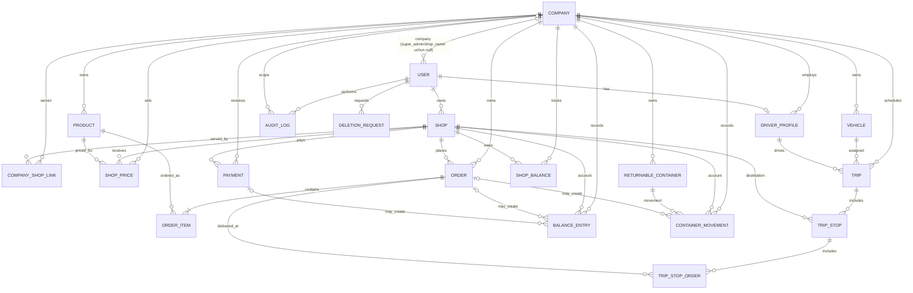

# ERD va API sxemasi — tasdiqlash uchun taklif

> **Holat:** ERD tasdiqlangan. Endpointlar jadvali API implementatsiyasi uchun
> kontrakt taklifidir. Ruxsatlar jadvali keyin amalga oshiriladigan
> avtorizatsiya qoidalarini ifodalaydi; hozir login oqimi mavjud emas.

## 1. ERD

Tasdiqlangan qaror: har bir foydalanuvchi ko‘pi bilan bitta kompaniyaga
tegishli; `super_admin` va `shop_owner` uchun kompaniya bog‘lanishi bo‘sh
bo‘lishi mumkin. `company_admin` va `driver` uchun kompaniya majburiy.

### Jadval va muhim maydonlar

| Jadval | Muhim maydonlar va cheklovlar |
|---|---|
| `Company` | `id`, `name`, `logo`, `brand_color`, `contact_phone`, `is_active`, vaqt tamg‘alari |
| `User` | `id`, `phone` (unikal), `company` (company_admin/driver uchun majburiy; super_admin/shop_owner uchun bo‘sh), `role`, `is_active`, `is_blocked`, o‘chirish holati, `is_staff`/`is_superuser`; parol/OTP oqimi bu bosqichda yo‘q |
| `Shop` | `owner` → User, `name`, `phone_primary` (unikal), `phone_secondary` (ixtiyoriy; faqat asosiy raqam unikal), `address`, `district`, `latitude`, `longitude`, `status` |
| `CompanyShopLink` | `company`, `shop`, `is_active`, yaratilgan vaqt; `(company, shop)` unikal |
| `Product` | `company`, `name`, `image`, `unit` (`piece`/`box`/`block`), `price`, `is_active` |
| `ShopPrice` | `company`, `shop`, `product`, `price` (ixtiyoriy maxsus narx), `discount_percent`; `(company, shop, product)` unikal; chegirma 0–100%; faqat shu kompaniyaga tegishli mahsulotga narx beriladi |
| `Order` | `company`, `shop`, `status`, `delivery_date`, `delivery_time_from`, `delivery_time_to`, `total_price`, izoh, vaqt tamg‘alari |
| `OrderItem` | `order`, `product`, `quantity`, `unit_price` (buyurtmadagi narx nusxasi), `line_total`; narx tarixini saqlash uchun `Product.price`dan mustaqil |
| `Vehicle` | `company`, `name`/`plate_number`, `capacity`, `is_active` |
| `DriverProfile` | `company`, `user` (unikal), haydovchi ma’lumotlari |
| `Trip` | `company`, `date`, `vehicle`, `driver`, `status`; mashina va haydovchi reys kompaniyasiga tegishli bo‘lishi shart |
| `TripStop` | `trip`, `shop`, `sequence`, `eta`, `delivered_at`, `note`; `(trip, sequence)` unikal; do‘konga bitta tashrif |
| `TripStopOrder` | `company`, `trip_stop`, `order`; bitta to‘xtash nuqtasiga bir nechta buyurtma bog‘lash uchun |
| `Payment` | `company`, `shop`, `amount`, `method`, `status`, `paid_at`, `reference`/izoh |
| `ShopBalance` | `company`, `shop`, joriy qarz balansi; `(company, shop)` unikal; ledgerdan yangilanadigan kesh |
| `BalanceEntry` | `company`, `shop`, `amount`, `direction` (`debit`/`credit`), `order` va/yoki `payment`, `posted_at`; asosiy ledger manbasi |
| `ReturnableContainer` | `company`, `name`, `unit`, `deposit_amount`, `is_active` |
| `ContainerMovement` | `company`, `shop`, `container`, `quantity_delta` (+ berildi / − qaytarildi), ixtiyoriy `order`, `created_at`; tara miqdori jurnaldan hisoblanadi, depozit qarz balansidan alohida |
| `AuditLog` | `company` (global voqea uchun null bo‘lishi mumkin), `actor`, `action`, `entity_type`, `entity_id`, `before`, `after`, `created_at` |
| `DeletionRequest` | `user`, `reason`, `requested_at`, `scheduled_for` (so‘rovdan 30 kun), `status`, `processed_at` |

### Sxema darajasidagi qoidalar

1. `Product`, `CompanyShopLink`, `ShopPrice`, `Order`, `Vehicle`,
   `DriverProfile`, `Trip`, `Payment`, balans/ledger va tara jadvallarida
   `company` majburiy FK bo‘ladi. Kompaniya qamrovidagi loglar uchun ham
   `company` bo‘yicha cheklangan so‘rov ishlatiladi; `AuditLog.company` maydoni
   global hodisani qo‘llash uchun ixtiyoriy qilib ko‘rsatilgan.
2. Har bir bog‘langan obyekt bir xil kompaniyaga tegishli ekanini faqat FK
   orqali kafolatlab bo‘lmaydi. Model/service validatsiyasi va kompaniya
   izolyatsiyasi testlari cross-company bog‘lanishlarni rad etishi kerak.
3. Pul qiymatlari decimal bo‘ladi; miqdorlar manfiy bo‘lmasligi, koordinatalar
   kenglik `[-90, 90]` va uzunlik `[-180, 180]` oralig‘ida bo‘lishi kerak.
4. Buyurtma, to‘lov va audit yozuvlari moliyaviy tarixni saqlash uchun qattiq
   o‘chirilmaydi. Do‘kon, mahsulot va transport arxivlanadi.
5. `ShopPrice.discount_percent` 0–100 foiz oralig‘ida bo‘ladi. Ixtiyoriy
   `ShopPrice.price` berilmasa `Product.price`, berilsa maxsus narx asos
   olinadi; chegirma shu narxga qo‘llanadi.

## 2. API sxemasi (taklif)

API prefiksi: `/api/v1/`. Barcha ro‘yxat javoblari sahifalangan bo‘lishi,
vaqtlar ISO 8601 formatida, pul qiymatlari decimal string sifatida qaytishi
taklif qilinadi. Quyidagi rol ustuni rejalashtirilgan ruxsatlarni bildiradi;
autentifikatsiya va ruxsatlarni tekshirish keyin amalga oshiriladi.

Qisqartmalar: `SA` = `super_admin`, `CA` = `company_admin`, `D` = `driver`,
`SO` = `shop_owner`. `CA` faqat o‘z kompaniyasi doirasida, `D` faqat o‘ziga
biriktirilgan reys doirasida, `SO` esa faqat o‘z do‘koni doirasida ishlaydi.

| URL | Metod | Kim kira oladi | Kirish maydonlari | Chiqish maydonlari |
|---|---|---|---|---|
| `/api/health/` | GET | Ommaviy | — | `status` |
| `/api/v1/companies/` | GET, POST | GET: SA; POST: SA | POST: `name`, `logo?`, `brand_color?`, `contact_phone?` | `id`, kompaniya maydonlari |
| `/api/v1/companies/{id}/` | GET, PATCH | SA; CA faqat o‘z kompaniyasini | PATCH: `name?`, `logo?`, `brand_color?`, `contact_phone?`, `is_active?` | kompaniya maydonlari |
| `/api/v1/users/` | GET, POST | SA; CA o‘z kompaniyasi foydalanuvchilari | POST: `phone`, `role`, `company_id?`, `is_active?` | `id`, `phone`, `role`, `is_active`, `is_blocked`, `company_id?` |
| `/api/v1/users/{id}/` | GET, PATCH | SA; CA o‘z kompaniyasi foydalanuvchilari | PATCH: `role?`, `is_active?`, `is_blocked?`, `company_id?` | foydalanuvchi maydonlari |
| `/api/v1/shops/` | GET, POST | SA/CA; SO faqat o‘z do‘koni | POST: `owner_id`, `name`, `phone_primary`, `phone_secondary?`, `address`, `district`, `latitude`, `longitude`, `status?` | do‘kon maydonlari, `company_links[]` |
| `/api/v1/shops/{id}/` | GET, PATCH | SA/CA; SO o‘z do‘konini | PATCH: do‘kon maydonlarining qisman to‘plami | do‘kon maydonlari |
| `/api/v1/companies/{company_id}/shops/` | GET, POST | SA/CA shu kompaniyada | POST: `shop_id`, `is_active?` | `id`, `company_id`, `shop_id`, `is_active` |
| `/api/v1/companies/{company_id}/shops/{shop_id}/` | PATCH, DELETE | SA/CA shu kompaniyada | PATCH: `is_active?`; DELETE: — | bog‘lanish yoki `204` |
| `/api/v1/products/` | GET, POST | SA/CA; SO ko‘rish | POST: `name`, `image?`, `unit`, `price`, `is_active?` | `id`, `company_id`, mahsulot maydonlari |
| `/api/v1/products/{id}/` | GET, PATCH | SA/CA; SO ko‘rish | PATCH: `name?`, `image?`, `unit?`, `price?`, `is_active?` | mahsulot maydonlari |
| `/api/v1/shops/{shop_id}/prices/` | GET, POST | SA/CA; SO o‘z do‘konidagi narxni ko‘rish | POST: `product_id`, `price?`, `discount_percent?` | `shop_id`, `product_id`, `price`, `discount_percent` |
| `/api/v1/shops/{shop_id}/prices/{id}/` | PATCH, DELETE | SA/CA; SO o‘qish | PATCH: `price?`, `discount_percent?`; DELETE: — | narx maydonlari yoki `204` |
| `/api/v1/orders/` | GET, POST | SA/CA; SO o‘z do‘koni | POST: `shop_id`, `delivery_date`, `delivery_time_from?`, `delivery_time_to?`, `items[{product_id, quantity}]`, `note?` | buyurtma, `items[]`, `total_price` |
| `/api/v1/orders/{id}/` | GET, PATCH | SA/CA; SO o‘z buyurtmasini | PATCH: `delivery_date?`, `delivery_time_from?`, `delivery_time_to?`, `note?` | buyurtma va pozitsiyalar |
| `/api/v1/orders/{id}/status/` | POST | SA/CA; D faqat biriktirilgan reysda | `status`, `note?` | `id`, `status`, `updated_at` |
| `/api/v1/vehicles/` | GET, POST | SA/CA | POST: `name`, `plate_number`, `capacity`, `is_active?` | transport maydonlari |
| `/api/v1/vehicles/{id}/` | GET, PATCH | SA/CA | PATCH: `name?`, `plate_number?`, `capacity?`, `is_active?` | transport maydonlari |
| `/api/v1/drivers/` | GET, POST | SA/CA | POST: `user_id`, haydovchi profil maydonlari | `id`, `user_id`, kompaniya doirasi |
| `/api/v1/trips/` | GET, POST | SA/CA; D o‘z reyslarini | POST: `date`, `vehicle_id`, `driver_id`, `stop_ids[]` yoki `stops[]` | reys, `stops[]` |
| `/api/v1/trips/{id}/` | GET, PATCH | SA/CA; biriktirilgan D o‘qishi | PATCH: `date?`, `vehicle_id?`, `driver_id?`, `status?` | reys va nuqtalar |
| `/api/v1/trips/{id}/stops/` | POST | SA/CA | `shop_id`, `sequence`, `eta?`, `order_ids[]?`, `note?` | reys nuqtasi va buyurtmalar |
| `/api/v1/trips/{id}/stops/{stop_id}/` | PATCH | SA/CA; shu reys haydovchisi | `sequence?`, `eta?`, `delivered_at?`, `note?` | nuqta maydonlari |
| `/api/v1/payments/` | GET, POST | SA/CA; SO o‘z do‘koni | POST: `shop_id`, `amount`, `method`, `paid_at?`, `reference?`, `note?` | to‘lov va `id` |
| `/api/v1/payments/{id}/` | GET | SA/CA; SO o‘z to‘lovi | — | to‘lov maydonlari |
| `/api/v1/shops/{shop_id}/balance/` | GET | SA/CA; SO o‘z do‘koni | — | `shop_id`, `balance`, `as_of` |
| `/api/v1/shops/{shop_id}/balance-entries/` | GET | SA/CA; SO o‘z do‘koni | Filter: `from?`, `to?`, `page?` | `results[{amount, source, order_id?, payment_id?, created_at}]` |
| `/api/v1/containers/` | GET, POST | SA/CA; SO ko‘rish | POST: `name`, `unit`, `deposit_amount?`, `is_active?` | tara turi maydonlari |
| `/api/v1/shops/{shop_id}/containers/` | GET | SA/CA; SO o‘z do‘koni | — | `results[{container_id, name, balance, unit}]` |
| `/api/v1/shops/{shop_id}/container-movements/` | GET, POST | SA/CA; D biriktirilgan yetkazishda | POST: `container_id`, `quantity_delta`, `order_id?`, `note?` | harakat yozuvi va yangilangan balans |
| `/api/v1/deletion-requests/` | GET, POST | POST: kirgan foydalanuvchi; GET: SA/CA | POST: `reason` | `id`, `status`, `requested_at`, `scheduled_for` |
| `/api/v1/deletion-requests/{id}/` | GET, PATCH | SA; so‘rov egasi faqat ko‘radi | PATCH: `status`, `review_note?` | so‘rov maydonlari |
| `/api/v1/audit-logs/` | GET | SA; CA faqat o‘z kompaniyasini | Filter: `actor_id?`, `entity_type?`, `from?`, `to?`, `page?` | `results[{actor_id, action, entity_type, entity_id, before, after, created_at}]` |
| `/api/schema/` | GET | Ichki hujjat siyosatiga ko‘ra | — | OpenAPI 3 sxemasi |
| `/api/docs/` | GET | Ichki hujjat siyosatiga ko‘ra | — | Swagger UI |

### OpenAPI hujjatlashtirish

Mavjud DRF/OpenAPI kutubxonasi bilan schema `/api/schema/`, Swagger UI esa
`/api/docs/` orqali berilishi rejalashtiriladi. Har bir endpointda serializer
maydonlari, majburiy/ixtiyoriy holat, validatsiya xatolari, sahifalash va
ruxsat sinflari hujjatlashtiriladi. Ushbu endpointlar ro‘yxati hozircha
kontrakt taklifidir, ishga tushadigan API emas.

## 3. Tasdiqlangan qarorlar

- Har bir foydalanuvchi bitta kompaniya bilan bog‘lanadi. `super_admin` va
  `shop_owner` kompaniyasiz bo‘lishi mumkin.
- Do‘konning asosiy telefoni unikal; qo‘shimcha telefon uchun unikal cheklov
  yo‘q.
- `ShopPrice.price` ixtiyoriy maxsus narx; `discount_percent` narxga
  foizli chegirma beradi.
- `BalanceEntry` qarzning asosiy ledgeri; `ShopBalance` tez o‘qish uchun kesh.
- Tara miqdori turi bo‘yicha harakatlar jurnalidan hisoblanadi; depozit qarz
  balansiga ta’sir qilmaydi.
- Bitta `TripStop` bitta do‘kon tashrifi bo‘lib, ko‘p `Order` bilan bog‘lanadi.
- Do‘kon, mahsulot va transport arxivlanadi; to‘lov qattiq o‘chirilmaydi.

Ushbu qarorlar asosida modellar, migratsiyalar, seed buyrug‘i va tenant
izolyatsiyasi testlari amalga oshirildi. API endpointlari va autentifikatsiya
keyingi bosqichlar uchun qoldirildi.
